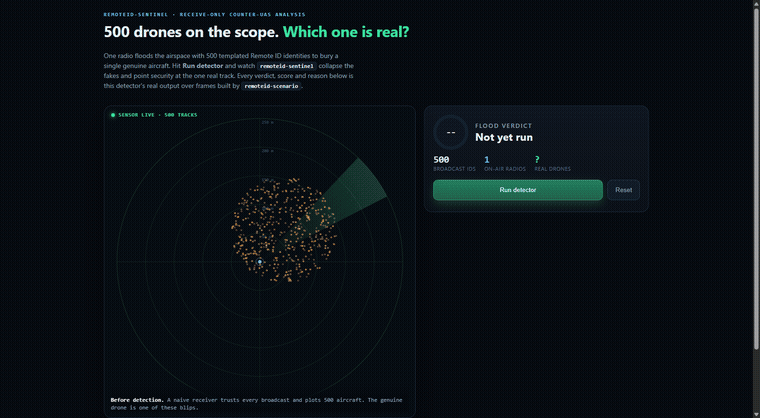

# Tensorust drone stack, live demos

**One drone can broadcast 500 fake Remote ID identities to hide in the noise. This collapses the flood back to the single real emitter, in your browser, with no backend.**

### [Open the live demos](https://mattbusel.github.io/drone-demos/)

Every decoded field, trust verdict and detection result on this page is produced by the open-source Tensorust Rust crates, run natively against real payloads (including DJI captures from the NDSS 2023 research dataset) and replayed in the browser. The scenarios are simulated so each story reads clearly, but nothing in the decode or the verdicts is faked and no capability is invented. The whole stack is receive-only: there is no transmit path anywhere in this code. The demos are self-contained and offline. Open `index.html` to browse the gallery, or open any demo folder's `index.html` directly. No backend, no build step, no network required.

## Demos

| Demo | What it shows | Crates |
|------|---------------|--------|
| [sentinel-flood](sentinel-flood/) | 500 fake Remote ID identities collapse to one emitter, revealing the real drone | `remoteid`, `remoteid-sentinel`, `remoteid-scenario` |
| [dji-pilot-reveal](dji-pilot-reveal/) | One OcuSync DroneID payload decoded; the drone broadcasts the pilot's location | `remoteid::dji` |
| [remoteid-to-tak](remoteid-to-tak/) | Remote ID bridged to Cursor-on-Target; spoofers arrive as suspect markers | `remoteid`, `uas-cot` |
| [spoofer-caught](spoofer-caught/) | Counter-UAS console: honest drones stay green, public spoofing tools flip red | `remoteid` |
| [flight-replay](flight-replay/) | 96,922 ArduPilot messages replayed to a battery-failsafe RTL | `flightlog-core` |
| [klv-fmv-overlay](klv-fmv-overlay/) | FMV exploitation station over real MISB ST 0601 telemetry with conformance checks | `misb` |

Plus byte-level decoders under [`bits/`](bits/): F3411 Basic ID, F3411 Location, DJI DroneID, MAVLink 2, ST 0601 KLV.

## Why it is trustworthy

The decoders follow the published standards directly: ASTM F3411 / ASD-STAN prEN 4709-002 for Open Drone ID, MISB ST 0601 for KLV full-motion-video metadata, and the MAVLink 2 / ArduPilot log formats for flight replay. Decode and detection run in the open-source crates themselves, not in hand-written demo glue, so what you see in the browser is the same code you would call in production. The DJI decode is validated against the NDSS 2023 DroneID captures rather than synthetic bytes.

## Crates

| Crate | Version | crates.io downloads |
|-------|---------|---------------------|
| [remoteid](https://crates.io/crates/remoteid) | 0.3.3 | 5,095 |
| [remoteid-sentinel](https://crates.io/crates/remoteid-sentinel) | 0.1.0 | new |
| [remoteid-scenario](https://crates.io/crates/remoteid-scenario) | 0.1.0 | new |
| [uas-cot](https://crates.io/crates/uas-cot) | 0.6.0 | 101 |
| [misb](https://crates.io/crates/misb) | 0.4.1 | 275 |
| [flightlog-core](https://crates.io/crates/flightlog-core) | 0.2.0 | 43 |
| [mavlink-tlog](https://crates.io/crates/mavlink-tlog) | 0.1.4 | 307 |

## Credits

The decoding these demos visualize stands on the open reverse-engineering work of the drone-RF community:

- **DJI DroneID** decoding is based on the reverse engineering by [proto17/dji_droneid](https://github.com/proto17/dji_droneid) and the academic work of the NDSS 2023 DroneID team (Schiller et al., RUB/CISPA). The DJI test payloads come from their published captures.
- **Open Drone ID / ASTM F3411** follows the [opendroneid](https://github.com/opendroneid) reference and the ASTM F3411 / ASD-STAN prEN 4709-002 specs.
- Spoofer fingerprints reference the public tools by cyber-defence-campus and jjshoots.

All decoding and detection in these demos is done by the open-source Rust crates: [remoteid](https://crates.io/crates/remoteid), [remoteid-sentinel](https://crates.io/crates/remoteid-sentinel), [remoteid-scenario](https://crates.io/crates/remoteid-scenario), [uas-cot](https://crates.io/crates/uas-cot), [misb](https://crates.io/crates/misb), [flightlog-core](https://crates.io/crates/flightlog-core). Scenarios are simulated; the decode and verdicts are real.
